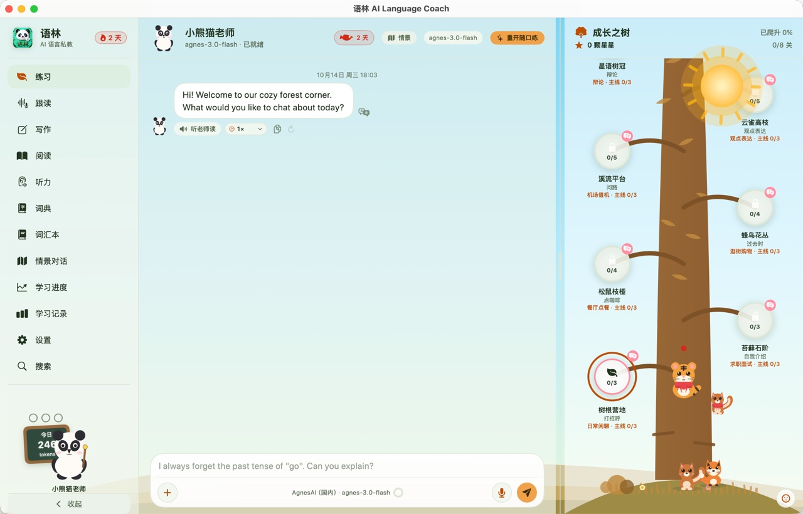
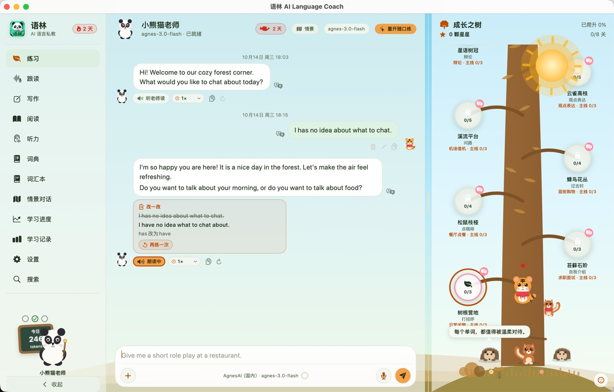
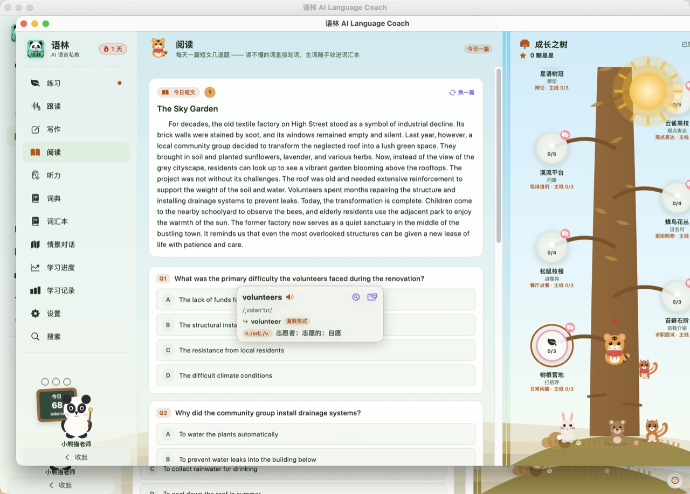
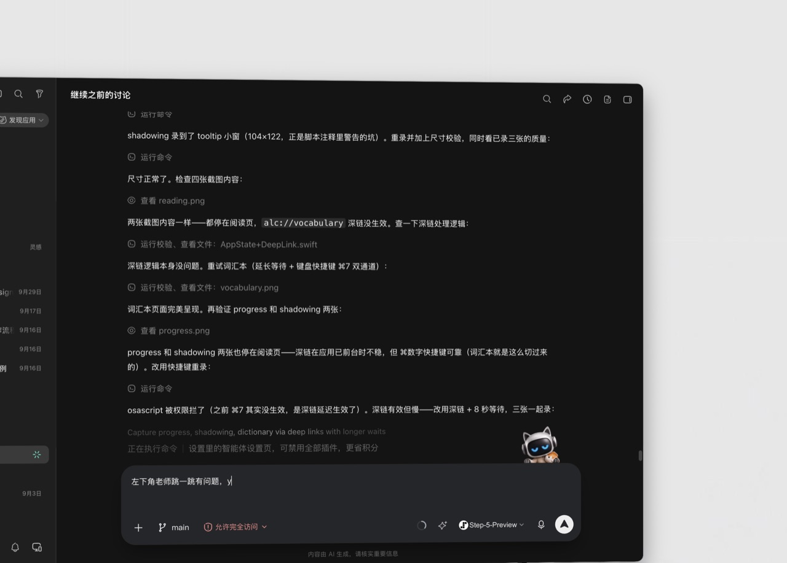
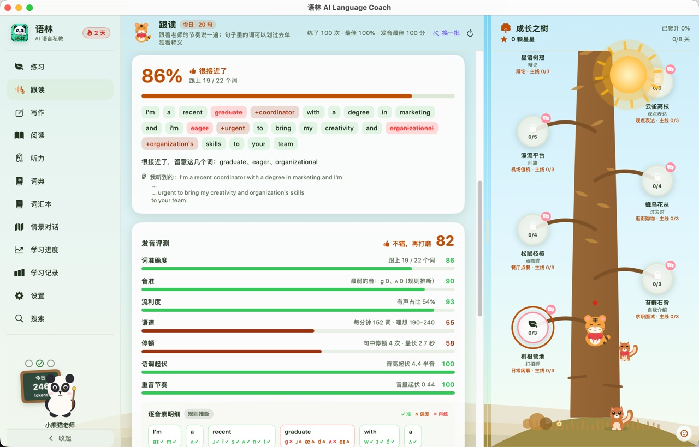
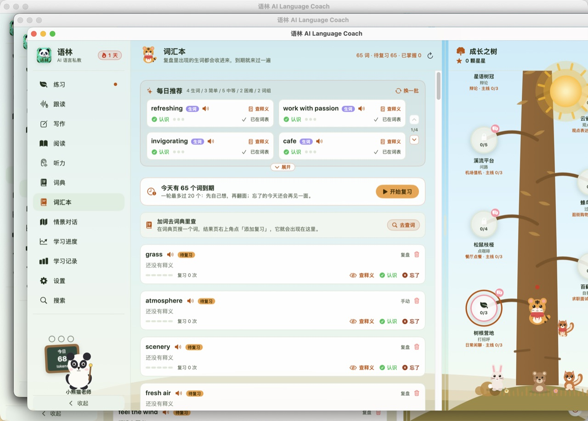
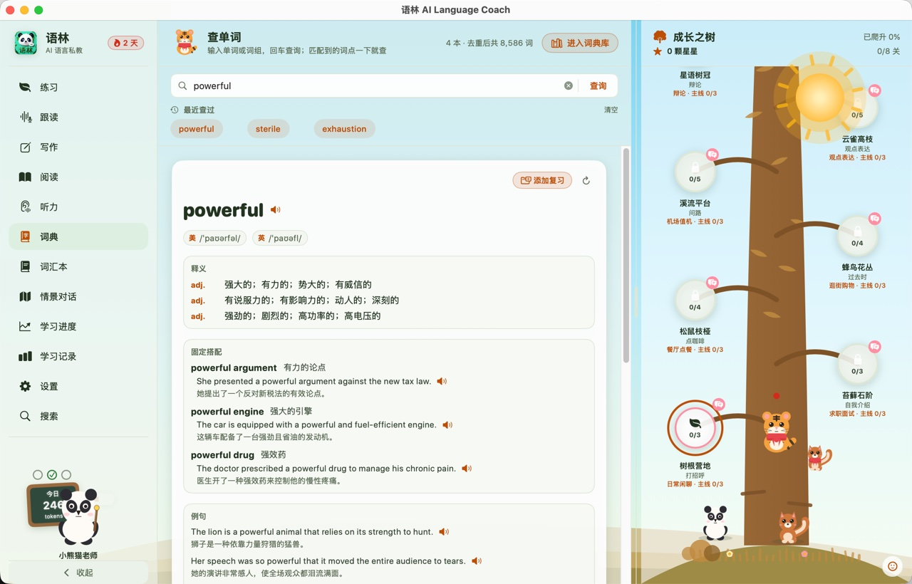

# 语林 AI Language Coach

<p align="center">
  
</p>

<p align="center">
  <strong>本地优先的 AI 语言私教 —— 听得懂、记得住、纠得准。</strong>
</p>

<p align="center">
  
  
  
  
</p>

---

语林是一款跑在 macOS 上的 AI 语言学习应用。它把「AI 私教 + 实时语音交互 + 发音纠正 + 长期学习记忆」装进一个原生应用：你对着电脑说话，老师用语音回应，说错了当场纠正，记下你反复犯的错误，每天替你安排该学什么。

**Local First**：核心能力（LLM / ASR / TTS / 发音评测 / 记忆索引）优先走本地模型，网络不是必需条件；模型可插拔，本地 Ollama 与主流云端 API 自由切换。你的学习数据只存在本机。

## 界面一览

<p align="center">
  
</p>

| 练习对话（带语法纠错卡） | 阅读 + 划词 |
| :---: | :---: |
|  |  |

| 学习进度 | 跟读评分 |
| :---: | :---: |
|  |  |

| 词汇本 | 词典查询 |
| :---: | :---: |
|  |  |

## 功能清单

### 学习主线

- **入学定级**：首次使用通过简短对话测定水平，老师从此按你的程度调整词汇难度、语速、句长与纠错频率。
- **每日任务 + 老师黑板**：左侧栏的「老师黑板」每天给出三项任务（练习时长 / 复习 / 新学），完成后全屏庆祝；右侧「成长之树」随学习天数生长。
- **AI 对话练习**：与 AI 老师自由对话。老师有稳定人设与教学风格，回复必然接住你上一句；支持语音输入与「听老师读」。
- **语法纠错卡片**：老师说错必落地——每次口头纠正都会生成一张红/绿/蓝三色纠错卡（错误原文 / 修改建议 / 原因讲解），自动进错题本，反复犯的错误会被反复追问。
- **情景对话**：一句话生成一个完整情景（机场、餐厅、面试、酒店、就医……），含多轮剧情与阶段目标；也支持面试模式，结束后给出 Strengths / Weaknesses / Recommended Practice 复盘。

### 输入输出训练

- **跟读（Shadowing）**：段落级跟读，逐句录音、逐句评分，分数与波形可视化；支持本地与云端发音评测（音素准确度 / 重音 / 语调 / 流畅度）。
- **听力**：三种形式——精听默写、关键词捕捉、听句选义。
- **写作**：每天一题，老师批改并给改写建议。
- **阅读**：每日短文 + 阅读理解四选一；文中任意单词划词出气泡，可直接查词典、加入词汇本。

### 词汇与工具

- **词典**：中英释义 + 音标 + 例句，划词即查。
- **词汇本**：从对话、阅读、听力各处一键收词；按记忆曲线安排复习（「认识 / 忘了」两键评级），每日推荐词源自动接入练习中遇到的生词。
- **学习进度**：能力定位、语法趋势、词汇增长、发音趋势、技能分布、本周小结，一页看全。
- **学习记录**：练习复盘、错题本、最近练习、打卡连续天数、年度学习记录。

### 体验与隐私

- **日夜双主题**：白天「森林时刻」与夜晚星月主题一键切换，另有动画效果与轻音效开关。
- **快捷键中心**：全部页面 ⌘1–⌘0 直达，快捷键可自定义。
- **数据自主**：学习库（SQLite）与配置都在本机应用数据目录，支持一键备份与恢复；应用内「隐私与安全」页列明每一项能力的数据去向——本地回环地址不算外发，联网能力一目了然。
- **提醒与目标**：可设置每日目标分钟数与练习提醒。

## 下载使用

前往 [Releases](https://github.com/QuinnLSY/AI_Language_Coach/releases) 页面下载最新版 `AI_Language_Coach.app`，解压后拖入「应用程序」即可。

首次打开如提示「无法验证开发者」：

```bash
xattr -dr com.apple.quarantine /Applications/AI_Language_Coach.app
```

**使用前提**：应用默认使用本地模型，需要本机已安装并运行 [Ollama](https://ollama.com/)（`ollama pull qwen3:8b`）。语音能力依赖本地服务（Edge-TTS 代理 / whisper.cpp），未启动时对应功能会提示不可用，可在「设置 → 模型提供商」中改用云端 API（DeepSeek / OpenAI / OpenRouter / AgnesAI / SiliconFlow 等，需自备密钥）或应用内置的 Mock Provider 先行体验。详见下方「本地配置」。

> 完整操作手册（图文）见项目主页：[GitHub Pages 产品介绍页](https://quinnlsy.github.io/AI_Language_Coach/)

## 本地构建

环境要求：**macOS 15 (Sequoia) 及以上，Swift 6.0 工具链**（Xcode 16+）。

```bash
git clone https://github.com/QuinnLSY/AI_Language_Coach.git
cd AI_Language_Coach

# 开发运行
swift run AILanguageCoach

# 跑测试（跳过依赖本机 Ollama 的集成用例）
swift test --disable-sandbox --skip "OllamaIntegrationTests"

# 打包为 .app（产物在 dist/）
zsh Scripts/make_app.sh
```

## 本地配置注意事项

| 能力 | 默认方案 | 说明 |
| :--- | :--- | :--- |
| LLM | Ollama `qwen3:8b`（`http://127.0.0.1:11434`） | 设置内可切换 `deepseek-r1:7b` 或任意云端 API |
| TTS（老师语音） | Edge-TTS 本地代理 `:8856`（免费，无需密钥） | 上游为微软 Edge TTS；它会按出口 IP 拒绝部分机房/VPN 出口，此时自动回退到备用在线源（Google 翻译朗读），无需干预。也可改本地 TTS `:8855` 或云端音色 |
| ASR（语音输入） | whisper.cpp `:8858`（`ggml-small.en`） | 也可换 OpenAI / Groq / SiliconFlow 云端识别 |
| 发音评测 | 内置 Mock（可用） | 接 Azure 发音评测可得声学级评分 |
| 记忆索引 | Ollama `nomic-embed-text` | 用于语义记忆检索；不可用时自动降级为关键词检索 |

- **本地服务未启动不会崩溃**：应用开屏会自动拉起已配置的本地服务（`service_start_command`），失败只在对应功能处提示不可用。
- **密钥只进本机**：云端 API 密钥写入本机配置，不随仓库分发；`default-config.json` 中不含任何密钥。
- **数据位置**：学习库 `learning.db`、配置 `config.json`、调用留痕 `remote-calls.jsonl` 均在本机应用数据目录，不随仓库分发，不会上传。
- **常见问题**：
  - 「听老师读」没声音：先看「设置 → 模型提供商」里语音服务是否为「运行中」；未运行时点一次「启动」即可（首次会请你确认本机启动命令）。若 Edge 上游被封，代理会在 5 分钟内改走备用在线源自动恢复；
  - 本地模型显示不可用：确认 Ollama 已启动且模型已 `pull`；
  - 打包后无法运行：确认用 `zsh Scripts/make_app.sh`（脚本依赖 zsh），并执行上方 `xattr` 解除隔离。

## 参与贡献

欢迎通过 [Issues](https://github.com/QuinnLSY/AI_Language_Coach/issues) 报告问题或提出建议！提交 PR 前请阅读：

- [AGENTS.md](AGENTS.md) —— 开发规范与工程纪律
- [Docs/](Docs/) —— PRD、技术设计、实施计划与代码审查记录

## 许可证

本项目采用 **AGPL-3.0 + 附加非商用条款** 双重许可：基础许可证为 GNU AGPL v3.0，并附加中文条款——**仅允许非商业目的使用**，禁止售卖、付费服务、商业主体内部创收或集成进商业产品。网络部署同样需要开放对应源代码。商业授权请通过 GitHub Issues 联系。

完整条款见 [LICENSE](LICENSE)。

---

<p align="center">用 ❤️ 与 Swift 打造 · 数据留在本机，学习日积月累</p>
